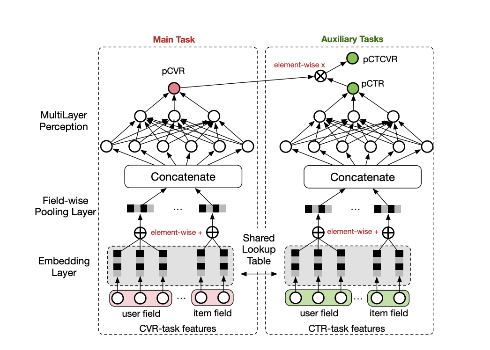
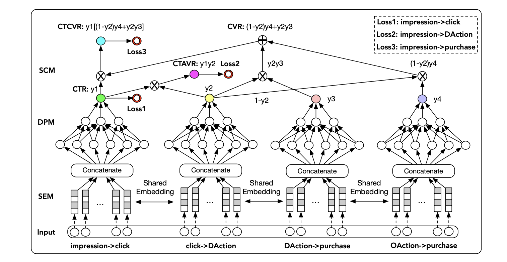
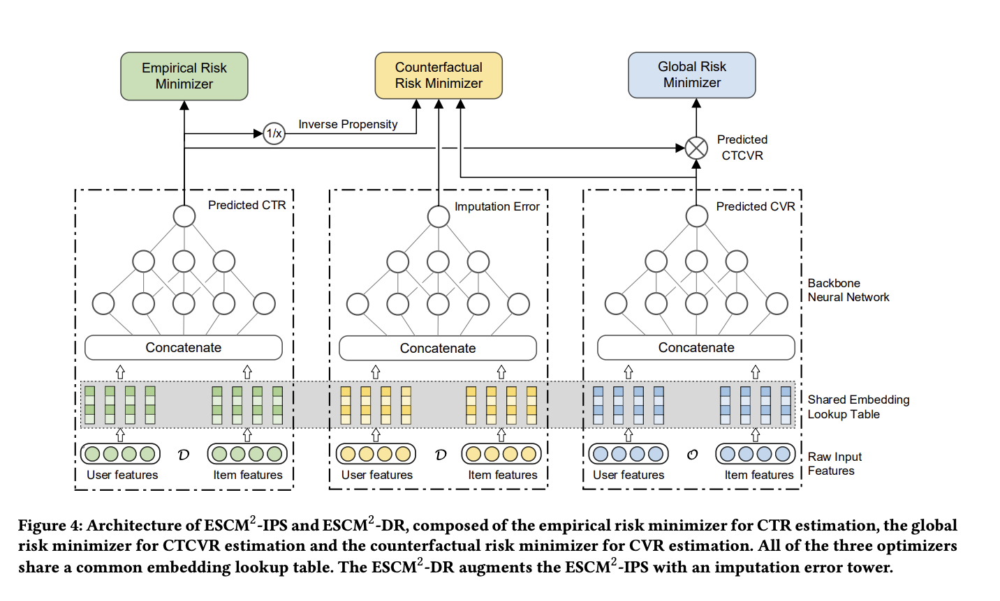
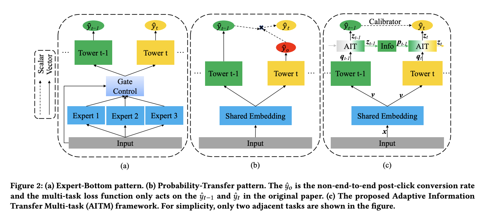
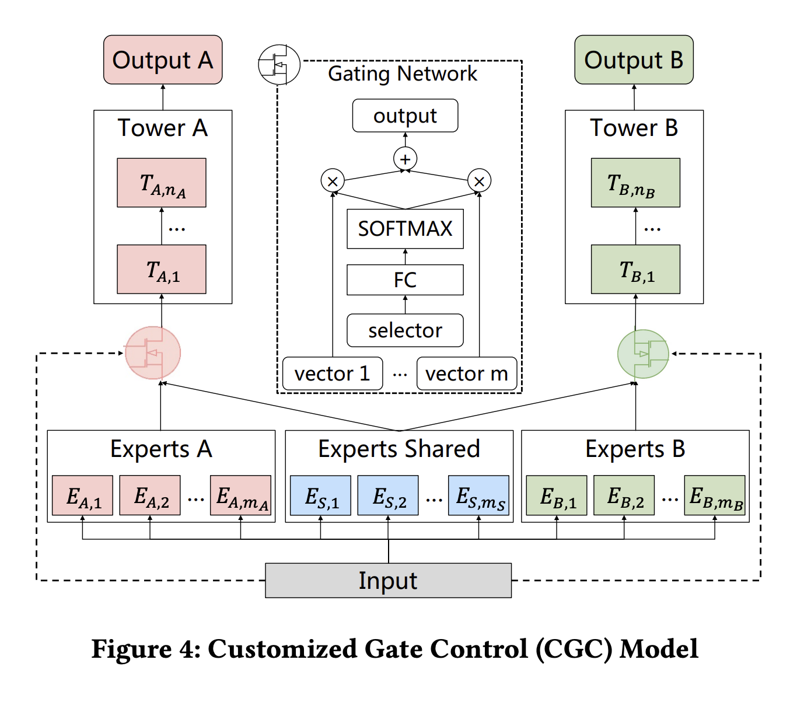
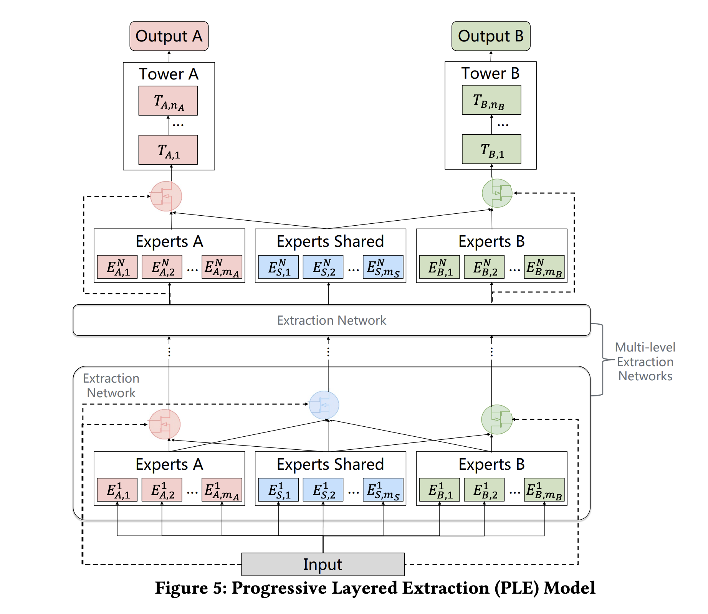

# Multi-Task Learning
Multi-Task Learning (MTL) is a type of machine learning technique where a model is trained to perform multiple tasks simultaneously. The goal of MTL is to improve the generalization performance of the model by leveraging the information shared across tasks. By sharing some of the network's parameters, the model can learn a more efficient and compact representation of the data, which can be beneficial when the tasks are related or have some commonalities.  
The idea is that you can train a big enough neural network to do well on all the tasks than training each network for each task separately when the network is big enough.  

## Loss Function of MTL
The loss function for multi task learning is as below. Note that $L\!\bigl(\hat{y}_{j}^{(i)},y_{j}^{(i)}\bigr)$ is usual logistic loss. But the difference is that summing over all the values of $j$, which is the node for the single task. For example, when developing simple autonomous driving model, the model has to distinguish the cars, pedestrians, stop signs and traffic light from the image. If applying this example to loss function, $n=4$ and each node will be matched with the cars, pedestrians, stop signs and traffic light.
$$
J \;=\; \frac{1}{m}\sum_{i=1}^{m}\;\sum_{j=1}^{n}
      L\!\bigl(\hat{y}_{j}^{(i)},\,y_{j}^{(i)}\bigr) \\[6pt]
L\!\bigl(\hat{y}_{j}^{(i)},y_{j}^{(i)}\bigr)
  \;=\;
  -\,y_{j}^{(i)}\,\log\hat{y}_{j}^{(i)}
  \;-\;\bigl(1-y_{j}^{(i)}\bigr)\,
        \log\!\bigl(1-\hat{y}_{j}^{(i)}\bigr).
$$
In practice we sum only over those label indices $j$ for which a valid binary target, $y_{j}^{(i)} \;\in\; \{0,1\}$ is present (missing labels are skipped).
If there are 4 features to detect, the $Y$ will be like below.
$$
Y \;=\;
\left[
\begin{array}{cccccc}
\color{red}{1} & \color{red}{1} & \color{red}{0} & ? & \cdots & ?\\[4pt]
0              & \color{red}{1} & \color{red}{1} & ? & \cdots & ?\\[4pt]
?              & ?              & \color{red}{1} & ? & \cdots & ?\\[4pt]
?              & ?              & \color{red}{0} & ? & \cdots & ?\\[2pt]
\end{array}
\right]
$$
As you can see from above $Y$, unlike softmax regrssion, in multi task learning one image could have multiple labels.

## When MTL works?
- When Training on a set of tasks that could benefit from having shared lower-level features.
- When the Amount of data you have for each task is quite similar.

## MTL methods (along with mestra case)
한 모델이 여러 과제를 함께 예측하게 하는 학습 방식이다. 추천·광고에서는 노출→클릭→전환처럼 순차로 일어나는 행동을 함께 예측할 때 많이 쓴다.

이 문서는 설계를 두 축으로 나눠 정리한다. 두 축은 서로 조합할 수 있다.

- 축 1: 과제 사이의 관계를 어떻게 다루는가
- 축 2: 본체를 어떻게 공유하는가

예시는 메시지 광고의 **발송 → 열람 → 클릭**을 쓴다. 앞 단계가 열람, 뒤 단계가 클릭이다. 논문 구조도를 해석할 때는 각 그림을 이 예시에 대입한 내용을 함께 적는다.

### 1. 축 1. 과제 사이의 관계를 다루는 방식

| 방식 | 구조 | loss | 특징 |
|---|---|---|---|
| 독립 head | 공유 본체 위에 열람·클릭 헤드 | `w1·BCE(열람) + w2·BCE(클릭)` | 가장 단순. 두 과제의 관계를 구조에 넣지 않음 |
| ESMM | 헤드가 `P(열람\|발송)`, `P(클릭\|열람)`을 내고 곱해서 `P(클릭\|발송)` | `BCE(p_열람, 열람) + BCE(p_열람 × p_클릭\|열람, 클릭)` | 전체 발송 행으로 학습. `P(클릭\|발송) ≤ P(열람\|발송)` 보장. `P(클릭\|열람)`은 간접 학습 |
| ESM2 | 단계 사이에 중간 행동을 더 끼워 넣어 확률을 잘게 분해 | 경로별 확률의 곱과 합에 loss | 최종 라벨이 매우 드물 때 사용. 열람과 클릭 사이에 넣을 행동이 있을 때만 해당 |
| ESCM2 | ESMM과 같음 | ESMM loss + `P(클릭\|열람)` 직접 loss (열람한 행에 `1/p_열람` 가중) | ESMM의 편향을 보정. 가중치 때문에 학습이 불안정할 수 있어 상한 튜닝 필요 |
| AITM | 과제별 타워. 열람 타워의 표현을 클릭 타워에 넘기고 attention으로 결합 | `BCE(열람) + BCE(클릭) + α·max(p_클릭 − p_열람, 0)` | 순차 관계를 강제하지 않고 유도. 열람 없이 클릭이 기록된 행이 있어도 깨지지 않음 |

#### 1.1 ESMM (Entire Space Multi-task Model)
     

순차로 일어나는 단계의 확률을 분해해서 학습한다.

```
공유 본체
   ├─ 열람 head → p_open  = P(열람|발송)
   └─ 클릭 head → p_ctor  = P(클릭|열람)
                  p_click = p_open × p_ctor = P(클릭|발송)
```

| loss | 예측값 | 라벨 | 학습에 쓰는 행 |
|---|---|---|---|
| 열람 loss | `p_open` | 열람 여부 | 발송 전체 |
| 클릭 loss | `p_open × p_ctor` | 클릭 여부 | 발송 전체 |

**클릭 loss를 곱한 값에 거는 이유**

- `P(클릭|열람)`을 직접 학습하려면 열람한 행만 써야 한다.
- 열람한 유저는 전체 발송 대상과 분포가 다르다(선택 편향). 서빙에서는 열람 여부를 모르는 채로 전체 발송 대상에 점수를 매긴다.
- 곱한 값에 loss를 걸면 두 loss 모두 전체 발송 행으로 학습된다. 이름의 "Entire Space"가 이 뜻이다.

**loss가 두 개여야 하는 이유**

- 곱의 loss 하나만 쓰면 열람 라벨이 학습에 들어가지 않는다.
- 두 헤드의 역할도 정해지지 않는다. 곱이 0.02여야 할 때 `0.2 × 0.1`이든 `0.5 × 0.04`든 loss가 같기 때문이다.
- 열람 loss가 `p_open`을 실제 열람 확률로 고정하면, 나머지 헤드가 자연히 `P(클릭|열람)`이 된다.

**한계**

- 클릭 head 출력(`p_ctor`)에는 직접 loss가 없다. 곱만 맞으면 되기 때문에 `p_ctor` 자체는 부정확할 수 있다.
- `P(클릭|발송)`만 쓸 경우에는 문제가 작고, `P(클릭|열람)`을 따로 쓰려면 문제가 된다.
- 열람 없이 클릭이 기록되는 행이 있으면 `p_click ≤ p_open` 제약이 그 행을 맞추지 못한다.

**논문 구조도 해석**

- **타워 구성:** 왼쪽이 주 과제인 CVR 타워, 오른쪽이 보조 과제인 CTR 타워이다.
- **공유 범위:** 두 타워는 임베딩 테이블(Shared Lookup Table)만 공유한다. 그 위의 pooling, concat, MLP는 타워마다 따로 둔다.
- **출력 결합:** 오른쪽 위의 ⊗에서 `pCVR × pCTR = pCTCVR`을 계산한다.
- **감독 여부:** 초록색인 `pCTR`과 `pCTCVR`에 loss가 걸린다. 빨간색인 `pCVR`에는 직접 loss가 없다.
- **학습 영역:** 두 타워 모두 전체 노출 데이터로 학습한다.

| 그림 | 발송 → 열람 → 클릭에 대입 |
|---|---|
| pCTR | `P(열람\|발송)` |
| pCVR | `P(클릭\|열람)` |
| pCTCVR | `P(클릭\|발송)` |

4절의 적용 구조와는 공유 범위가 다르다. 원 논문은 임베딩만 공유하고 MLP는 타워별로 두지만, 4절의 구조는 head MLP까지 공유하고 출력층만 나눈다. Mestra 모델에는 임베딩 테이블이 없으므로 공유 범위는 새로 정해야 하는 선택이다.

#### 1.2 ESM2
     

- 클릭과 구매 사이에 중간 행동(장바구니, 찜 등)을 끼워 넣어 단계를 늘린다.
- 경로별 확률을 곱하고 더해 최종 확률을 만든다.
- 최종 라벨이 너무 드물 때, 더 흔한 중간 행동을 감독 신호로 쓰려는 목적이다.

**논문 구조도 해석**

클릭과 구매 사이를 행동 종류로 한 번 더 분해한 구조이다.

| 출력 | 의미 |
|---|---|
| y1 | 노출 → 클릭 |
| y2 | 클릭 → 결정적 행동(DAction: 장바구니, 찜 등) |
| y3 | 결정적 행동 → 구매 |
| y4 | 그 밖의 행동(OAction) → 구매 |

- **세 층:** SEM에서 네 타워가 임베딩을 공유하고, DPM에서 타워별 MLP가 y1~y4를 내며, SCM에서 확률을 곱하고 더해 최종 확률을 조립한다.
- **`CTAVR = y1 × y2`:** 노출에서 결정적 행동까지의 확률이다. Loss2가 걸린다.
- **`CVR = y2·y3 + (1 − y2)·y4`:** 결정적 행동을 거친 경로와 거치지 않은 경로의 구매 확률을 더한 값이다.
- **`CTCVR = y1 × CVR`:** 노출에서 구매까지의 확률이다. Loss3이 걸린다.
- **y1:** Loss1이 걸린다.

세 loss 모두 노출(impression)에서 시작하므로 전체 노출 행으로 학습한다. y2, y3, y4에는 직접 loss가 없고 조립된 값으로만 학습된다. 열람과 클릭 사이에 넣을 중간 행동이 있을 때만 발송 → 열람 → 클릭에 대입할 수 있다.

#### 1.3 ESCM2
     

ESMM의 문제 두 가지를 지적하고 보정한다.

1. 뒤 단계 확률(`P(클릭|열람)`)이 실제보다 높게 추정된다.
2. 곱한 확률을 학습할 때 앞 단계에서 뒤 단계로 가는 인과 관계를 놓칠 수 있다.

- **해법:** ESMM loss에 뒤 단계 헤드의 직접 loss를 정규화 항으로 더한다.
- **직접 loss의 형태:** 앞 단계가 일어난 행에만 걸고 `1/p_앞`으로 가중한다(IPS). 보조 타워로 오차를 추정해 보정하는 변형(DR)도 있다.
- **loss:** `L_앞 + λ1 × L_뒤(보정) + λ2 × L_곱`

**논문 구조도 해석**

ESMM에 CVR 타워의 직접 loss를 더한 구조이다. 타워는 CTR, Imputation Error, CVR 세 개이고 임베딩 테이블만 공유한다. Imputation Error 타워는 그림 설명에 따르면 DR 변형에만 있다.

| loss | 대상 | 입력 |
|---|---|---|
| Empirical Risk Minimizer | CTR | CTR 타워 출력 |
| Counterfactual Risk Minimizer | CVR (직접) | CTR의 역수(`1/x`, Inverse Propensity), Imputation Error, CVR 예측 |
| Global Risk Minimizer | CTCVR | ⊗에서 CTR과 CVR을 곱한 값 |

- **핵심은 Counterfactual Risk Minimizer이다.** ESMM에는 없던 CVR 직접 loss이고, 클릭 확률의 역수로 가중해 클릭한 행만 관측된다는 편향을 보정한다.
- **화살표가 향하는 곳:** CTR, Imputation Error, CVR 타워에서 나온 화살표는 가운데 타워가 아니라 그 위의 Counterfactual Risk Minimizer로 들어간다. 이 상자는 모델이 아니라 loss 계산식이다.
- **𝒟와 𝒪 표시:** CTR 타워와 Imputation 타워 입력에는 𝒟, CVR 타워 입력에는 𝒪가 있다. 𝒟는 전체 노출, 𝒪는 클릭이 관측된 행을 뜻하는 것으로 보이나 그림만으로는 기호의 정의를 확인할 수 없다.
- **발송 → 열람 → 클릭에 대입:** Counterfactual Risk Minimizer는 열람한 행에 `1/P(열람)` 가중치를 주어 `P(클릭|열람)`을 직접 학습하는 loss에 해당한다.

**IPS와 DR의 역할 정리**

Inverse Propensity(IPS)와 Imputation Error(DR)가 각각 무엇을 해결하는지 단계별로 정리한다. 그림에는 없는 내용이고, IPS와 DR의 일반적인 정의에 기반한 설명이다.

1. **편향:** 클릭한 행만으로 학습하면 pCTR이 높은 그룹 쪽으로 치우친다. 클릭한 행에는 그런 그룹이 실제 노출 비율보다 많이 들어 있기 때문이다.
2. **가중치 보정 (IPS):** 클릭한 행의 loss에 `1/pCTR` 가중치를 주어, pCTR이 낮은 그룹의 비중을 원래 노출 비율만큼 되살린다. 편향은 이 단계에서 해결된다.
3. **가중치의 부작용:** pCTR이 낮은 그룹은 클릭된 소수의 행이 각각 큰 가중치를 갖고 그룹 전체를 대표한다. 그래서 몇 건의 우연에 학습이 크게 흔들린다.
4. **추정 loss 보정 (DR):** 가운데 타워가 모든 행의 loss를 추정해 기본값으로 둔다. 클릭된 행은 추정이 틀린 만큼인 `(e − ê)`에만 가중치를 곱한다. 그룹의 비중은 그대로 두고 흔들림만 줄인다.

요약하면 `1/pCTR` 가중치는 편향을 없애고, 추정 loss는 그 가중치 때문에 생기는 불안정성을 줄인다.

#### 1.4 AITM (Adaptive Information Transfer Multi-task)
     

확률을 곱하지 않고, 앞 단계의 정보를 뒤 단계로 넘긴다.

```
공유 본체
   ├─ 열람 타워 → 표현 q_open ──→ P(열람|발송)
   │                  │ 변환해서 전달
   │                  ▼
   └─ 클릭 타워 → 표현 q_click ─→ [전달받은 표현 + q_click 을 attention 으로 결합] → P(클릭|발송)
```

- **넘어가는 것:** 예측된 열람 확률(숫자 하나)이 아니라 열람 타워의 중간 표현(벡터)이다.
- **결합:** 클릭 타워는 자기 표현과 넘겨받은 표현을 attention으로 가중해 섞는다. 행마다 열람 쪽 정보를 얼마나 쓸지 다르게 정한다.
- **순차 관계:** 구조로 강제하지 않고 loss의 벌점 항으로 유도한다. `p_click`이 `p_open`을 넘으면 손해를 보게 한다.
- **ESMM과의 차이:** 두 헤드 모두 자기 라벨로 직접 감독을 받는다. 대신 `p_click ≤ p_open`은 보장되지 않는다.

**논문 구조도 해석**

세 가지 패턴을 나란히 비교한 그림이다. 범례에 따르면 점선 화살표는 숫자 하나(Scalar), 실선은 벡터(Vector)이다.

| 패턴 | 구조 | 과제 사이에 전달되는 것 |
|---|---|---|
| (a) Expert-Bottom | Expert 여러 개와 Gate Control 위에 과제별 Tower를 둔다. MMoE 계열이다. | 없음. 아래쪽 공유 부분으로만 연결된다. |
| (b) Probability-Transfer | 앞 단계 확률과 타워 출력을 곱해 다음 단계 확률을 만든다. ESMM 계열이다. | 확률 숫자 하나(점선) |
| (c) AITM | AIT 모듈이 자기 타워의 표현 `q(t)`와 앞 단계에서 넘어온 `p(t−1)`을 받아 `z(t)`를 만들고, `z(t)`에서 예측값을 낸다. Info 모듈이 `z(t−1)`을 `p(t−1)`로 변환해 넘긴다. | 표현 벡터(실선) |

- **(b)의 loss:** 그림 설명에 따르면 앞 단계 확률과 곱한 확률에만 loss를 건다. 1.1절 ESMM의 loss 두 개와 같은 내용이다.
- **논문의 주장:** (b)처럼 확률 숫자 하나를 곱하는 대신, (c)처럼 앞 단계의 표현 벡터를 넘겨 얼마나 반영할지를 학습하게 한다.
- **넘어가는 벡터:** `z(t−1)`은 열람 확률을 내는 출력층 바로 앞의 마지막 hidden state이다. 예측한 확률이 아니라 이 벡터가 Info로 넘어간다.
- **그림으로 확인되지 않는 것:** 전달 경로에서 gradient를 끊는지, AIT 모듈 내부가 attention인지는 그림에 나오지 않는다.

**AIT와 Info**

- **공통:** 둘 다 학습되는 파라미터를 가진 모듈이고, 타워와 함께 같은 loss로 학습된다.
- **Info:** `z(t−1)`은 열람을 맞히도록 학습된 표현이므로, 그대로 넘기지 않고 한 번 변환한다.
- **AIT:** 넘어온 정보와 자기 타워의 표현을 각각 얼마나 쓸지 행마다 다르게 정한다.

**Calibrator**

- **그림에서의 위치:** 두 예측값 사이의 점선이다. 구조가 아니라 loss에서 두 확률의 순서를 맞추는 장치이다.
- **필요한 이유:** (c)는 두 확률을 곱하지 않고 타워별로 따로 예측한다. 그래서 `P(클릭|발송)`이 `P(열람|발송)`보다 크게 나올 수 있다. 열람해야 클릭할 수 있으므로 논리적으로 맞지 않는 결과이다.
- **동작:** 순서가 뒤집힌 경우에만 벌점을 준다. 식은 `α · max(ŷ(t) − ŷ(t−1), 0)`이다. 이 식은 그림에 없는 내용이다.

**예측 열람률을 피처로 넣는 방식과의 차이**

| | 예측 열람률을 피처로 넣기 | AITM |
|---|---|---|
| 넘어가는 것 | 확률 숫자 하나 | 열람 타워의 표현 벡터 |
| 담기는 정보 | 열람할 것 같은 정도 | 왜 열람할 것 같은지까지 포함 |
| 결합 방식 | 입력에 이어 붙임 | attention으로 가중 결합 |

#### 1.5 독립 head

- 공유 본체 위에 헤드를 과제 수만큼 단다.
- loss는 과제별 BCE의 가중합이다. 가중치가 주된 튜닝 대상이다.
- 두 과제의 관계를 구조에 넣지 않아서, 추가한 과제는 보조 신호 역할만 한다.

### 2. 축 2. 본체를 공유하는 방식

| 방식 | 구조 | 특징 |
|---|---|---|
| Shared-bottom | 은닉층 전체를 공유하고 헤드만 과제별로 분리 | 파라미터가 가장 적음. 과제 관련성이 약하면 서로 성능을 깎음 |
| MMoE | 공유 본체를 전문가 네트워크 K개로 대체. 과제마다 게이트가 전문가 가중치를 정함 | 과제마다 전문가 조합이 달라 간섭이 줄어듦 |
| CGC | 전문가를 공유 전문가와 과제 전용 전문가로 분리. 과제의 게이트는 자기 전용과 공유 전문가만 봄 | PLE의 한 층짜리 형태. 과제마다 다른 과제가 건드리지 않는 파라미터를 가짐 |
| PLE | CGC와 비슷한 층을 여러 개 쌓고, 층마다 공유 게이트를 둠 | 한 과제가 오르면 다른 과제가 내려가는 시소 현상을 줄임 |

#### 2.1 Shared-bottom

- 은닉층 전체를 모든 과제가 공유하고, 마지막 헤드만 과제별로 나눈다.
- 과제끼리 관련이 약하면 한 과제가 다른 과제의 성능을 깎는다.

#### 2.2 MMoE (Multi-gate Mixture-of-Experts)

- 공유 본체를 전문가 네트워크 K개(각각 작은 MLP)로 대체한다.
- 과제마다 게이트가 하나씩 있고, 입력을 보고 전문가 K개에 대한 softmax 가중치를 낸다.
- 각 과제의 헤드는 자기 게이트로 가중합한 전문가 출력을 받는다.

#### 2.3 CGC (Customized Gate Control)
     

PLE 논문이 PLE에 앞서 제시한 구조이다. 전문가를 공유와 과제 전용으로 나누고, 과제마다 게이트가 그중 쓸 수 있는 전문가만 골라 가중합하는 한 층짜리 구조이다.

| 요소 | 내용 |
|---|---|
| 전문가(Expert) | 입력을 받아 벡터를 내는 작은 네트워크. 논문 실험에서는 한 층짜리로 구현했다. |
| 전문가 묶음 | A 전용, 공유, B 전용 세 묶음. 묶음별 전문가 수는 하이퍼파라미터이다. |
| 게이트 | 과제마다 하나. Linear 한 층에 softmax를 붙인 구조이다. |
| 타워 | 과제마다 하나. 여러 층 MLP로 최종 예측을 낸다. |

**계산 순서** (과제 A 기준, A 전용 전문가 2개와 공유 전문가 3개인 경우)

1. 모든 전문가가 같은 입력 `x`를 받아 각자 벡터를 낸다.
2. 게이트 A가 입력 `x`를 Linear와 softmax에 통과시켜 가중치 5개를 낸다. 합은 1이다.
3. A가 쓸 수 있는 전문가 5개의 출력을 그 가중치로 더해 벡터 하나를 만든다.
4. 타워 A가 그 벡터로 예측한다.

#### 2.4 CGC와 MMoE 비교

CGC는 MMoE에 과제 전용 전문가를 더한 구조이다.

- **MMoE:** 전문가가 전부 공유이다. 어떤 전문가를 어느 과제가 주로 쓸지는 게이트가 학습하면서 정해진다. 역할 분담이 암묵적이다.
- **CGC:** 공유 전문가는 그대로 두고, 과제마다 전용 전문가를 따로 둔다. 역할 분담의 일부를 구조로 미리 정해 둔 것이다.

#### 2.5 PLE (Progressive Layered Extraction)
     

MMoE에서도 남는 시소 현상을 줄이려는 구조이다. CGC와 비슷한 층(Extraction Network)을 여러 개 쌓는다.

- **공유 게이트:** 마지막 층을 뺀 각 층에 있다. 그 층의 모든 전문가를 섞어 다음 층의 공유 전문가에 넘긴다.
- **점진적 분리:** 아래층에서는 과제 사이에 정보가 섞이고, 위로 갈수록 분리된다.

#### 2.6 CGC와 PLE의 loss와 학습 범위

전체 loss는 과제별 loss의 가중합 `L = ω_A · L_A + ω_B · L_B`이다. 하나의 loss를 역전파하지만 연결이 없는 곳에는 gradient가 흐르지 않으므로, 학습 대상마다 받는 loss가 달라진다. 전문가뿐 아니라 게이트와 타워도 함께 학습된다.

| 학습 대상 (CGC) | 받는 loss |
|---|---|
| A 전용 전문가, 게이트 A, 타워 A | A의 loss |
| B 전용 전문가, 게이트 B, 타워 B | B의 loss |
| 공유 전문가 | 가중합한 전체 loss |

- **공유 전문가가 받는 신호의 크기:** 게이트 가중치에 비례한다. 게이트 A가 어떤 공유 전문가에 낮은 가중치를 주면 A의 loss가 그 전문가에 주는 영향도 그만큼 작다.
- **PLE의 마지막 층:** CGC와 같다. 전용 전문가는 자기 과제의 loss만 받는다.
- **PLE의 아래층:** 전용 전문가도 다른 과제의 loss를 받는다. 공유 게이트가 모든 전문가를 섞어 위층의 공유 전문가로 넘기기 때문이다. 예를 들어 B의 loss는 `타워 B → 2층 게이트 B → 2층 공유 전문가 → 1층 공유 게이트 → 1층 A 전용 전문가` 경로로 전달된다.

논문도 초기 층에서는 과제별 파라미터가 완전히 분리되지 않고 위로 갈수록 분리된다고 적고 있다. 점진적 분리(Progressive)가 가리키는 것이 이 부분이다.

### 3. 논문 정보

인용수는 Semantic Scholar 2026-11-19 조회 기준이다.

| 모델 | 논문 제목 | 소속 | 발표 | 인용수 |
|---|---|---|---|---|
| Shared-bottom | Multitask Learning | CMU | Machine Learning, 1997 | 9,029 |
| MMoE | Modeling Task Relationships in Multi-task Learning with Multi-gate Mixture-of-Experts | Google | KDD 2018 | 1,889 |
| PLE | Progressive Layered Extraction (PLE): A Novel Multi-Task Learning (MTL) Model for Personalized Recommendations | Tencent | RecSys 2020 | 895 |
| ESMM | Entire Space Multi-Task Model: An Effective Approach for Estimating Post-Click Conversion Rate | Alibaba | SIGIR 2018 | 599 |
| ESM2 | Entire Space Multi-Task Modeling via Post-Click Behavior Decomposition for Conversion Rate Prediction | Alibaba | SIGIR 2020 | 170 |
| AITM | Modeling the Sequential Dependence among Audience Multi-step Conversions with Multi-task Learning in Targeted Display Advertising | Meituan | KDD 2021 | 147 |
| ESCM2 | ESCM²: Entire Space Counterfactual Multi-Task Model for Post-Click Conversion Rate Estimation | Ant Group | SIGIR 2022 | 141 |

CGC는 PLE 논문에서 함께 제안된 구조이다.

### 4. 적용 사례: Mestra psCTR 모델에 열람 예측 추가

현재 모델은 발송 대비 클릭 확률 하나만 예측한다. 구조는 아래와 같다.

```
입력 결합(1816d) → 병렬 cross → head MLP(3632 → 1024 → 1024) → Linear 1 + sigmoid
```

여기에 열람 예측을 두 번째 과제로 넣을 때의 조합별 변경 범위이다.

| 조합 | 바뀌는 부분 | 기존 코드 변화량 |
|---|---|---|
| Shared-bottom + 독립 head | 마지막 출력층만 둘로 분리 | **작음.** 본체에 출력층 하나 추가. 파라미터 약 1천 개 증가. 본체 가중치 전부 재사용 가능 |
| Shared-bottom + ESMM | 위와 같고, 클릭 loss를 두 확률의 곱에 걸기 | **작음.** 위와 같고 loss 계산만 다름. 서빙 출력을 곱한 값으로 바꾸는 처리 추가 |
| Shared-bottom + AITM | head MLP를 과제별 타워로 나누고 전달 모듈 추가 | **중간.** 타워와 전달·attention 모듈을 새로 작성. 파라미터 수십만~수백만 개 증가. cross 층까지만 가중치 재사용 가능 |
| MMoE·PLE + 위 방식 | head MLP를 전문가 여러 개로 교체 | **큼.** head 전체를 전문가·게이트 구조로 재작성. 전문가당 약 477만 개 증가. cross 층까지만 가중치 재사용 가능 |

**모든 조합에 공통으로 드는 변경**

- 학습 데이터에 열람 라벨 추가
- 학습 래퍼의 loss와 검증 지표를 두 과제용으로 변경
- ONNX 출력과 calibration 게이트 재정의
- 온라인 모델 재시드, 메시지별 어댑터를 붙일 위치 재정의

**선택 기준**

- 출발점은 코드 변화량이 작은 Shared-bottom + ESMM이다.
- 열람 없이 클릭이 기록되는 행이 많으면 확률 분해가 맞지 않으므로 AITM이나 독립 head가 낫다.
- `P(클릭|열람)`도 따로 쓰려면 ESCM2가 필요하다.
- MMoE·PLE는 열람 과제를 넣었을 때 클릭 지표가 떨어지는 것이 확인될 때만 검토한다. 파라미터의 73%가 head MLP에 있어서 학습 시간과 서빙 비용이 크게 늘어난다.

### 5. 참고 문헌

- [ESMM (arXiv 1804.07931)](https://arxiv.org/abs/1804.07931)
- [ESM2 (arXiv 1910.07099)](https://arxiv.org/abs/1910.07099)
- [ESCM2 (arXiv 2204.05125)](https://arxiv.org/abs/2204.05125)
- [AITM (arXiv 2105.08489)](https://arxiv.org/abs/2105.08489)
- [MMoE (KDD 2018)](https://doi.org/10.1145/3219819.3220007)
- [PLE (RecSys 2020)](https://doi.org/10.1145/3383313.3412236)
- [Multitask Learning (Caruana, 1997)](https://doi.org/10.1023/A:1007379606734)