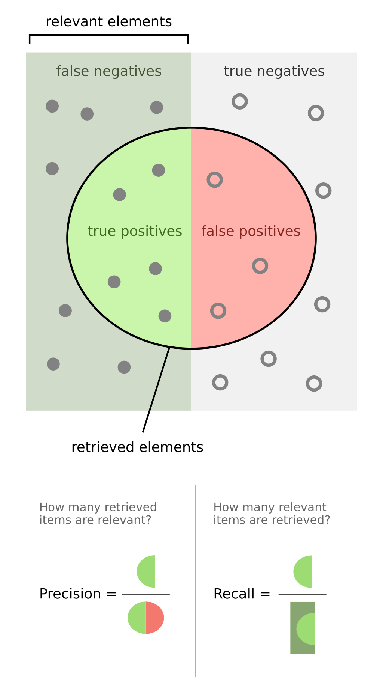
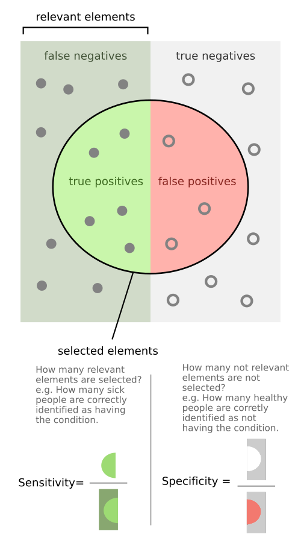
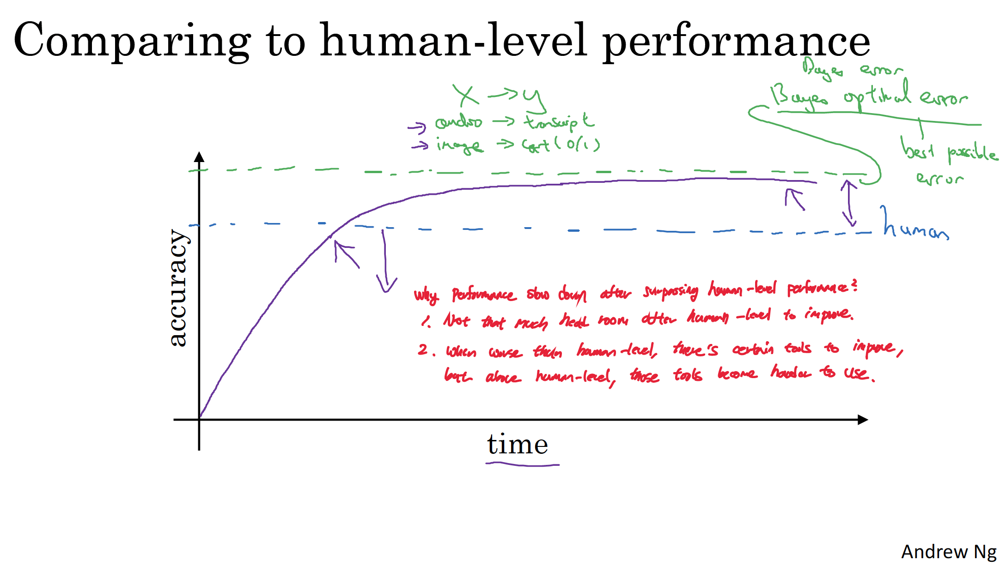
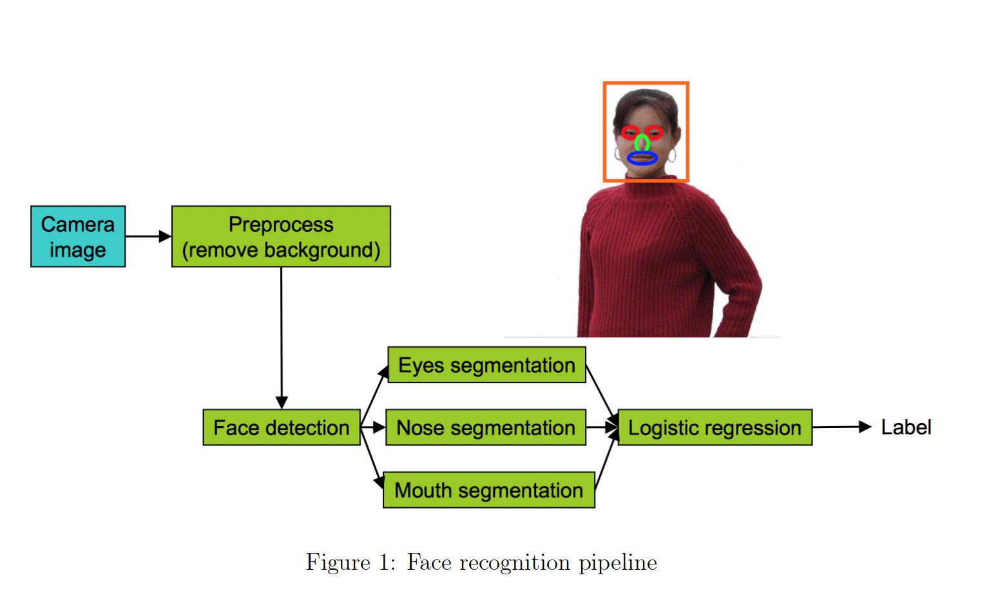
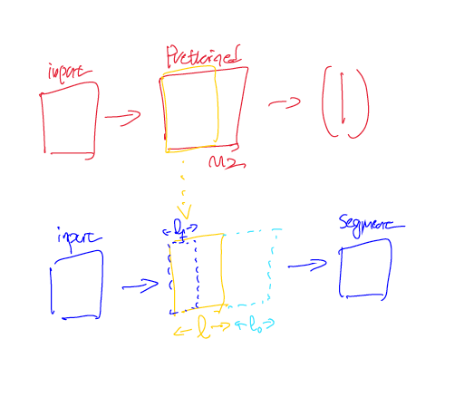
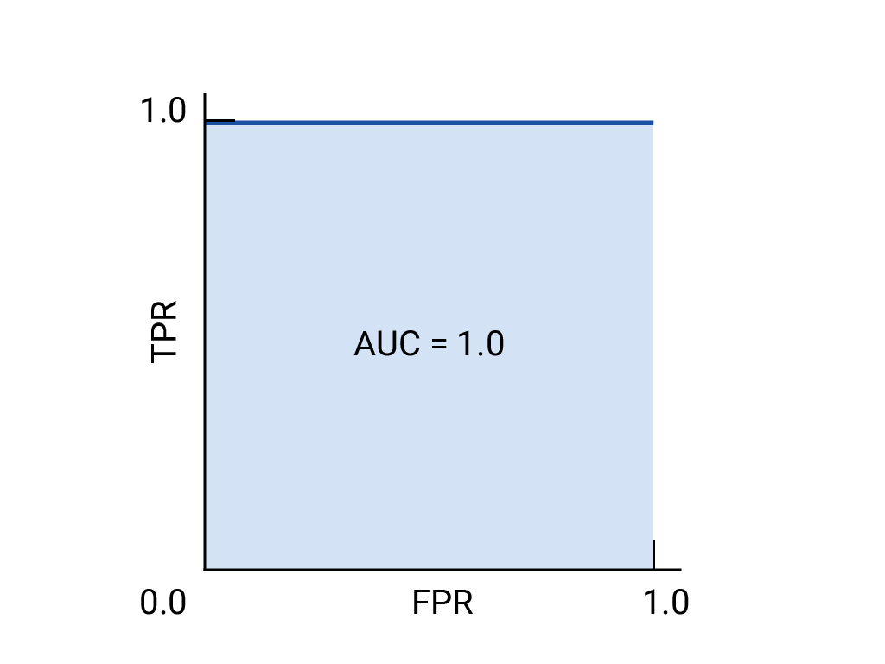
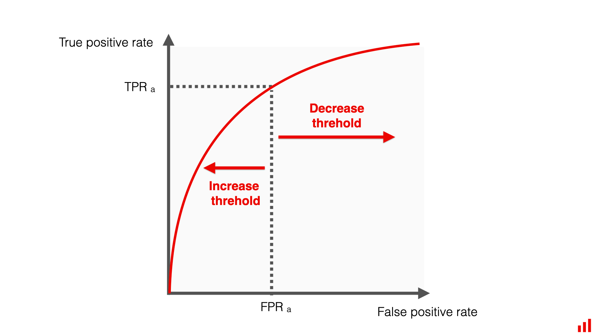

# Machine Learning Strategy
## Background
Why would we need strategy for machine learning? Let me give you an example. Let's say that you get $90$ % accuracy and itis not enough, figure out which of all of these ideas (or other ideas) are worth pursuing and which ones you can safely discard.

 - Collect more data
 - Collect more diverse training set
 - Train algorithm longer with gradient descent
 - Try Adam instead of gradient descent
 - Try bigger network
 - Try smaller network
 - Try dropout
 - Add L-2 regularization
 - Network architecture
   - Activation functions
   - Number of hidden units

## Orthogonalization
Orthogonalization is a system design property that ensures that modification of an instruction or an algorithm component does not create or propagate side effects to other system components.
### Benefits of Orthogonalization
1. Orthogonalization can lead to improved model performance by reducing the complexity and ensuring that each component of the model works efficiently.  
2. Separating concerns through orthogonalization simplifies the debugging process, as issues in one component are less likely to affect others, making the model easier to maintain and update.

For example, when you are driving a car, handle should only control the steering and gear should only control the acceleration. If handle is controlling both steering and acceleration, or vice versa, driving would become much more complex job.

### Chain of Assumptions in Machine Learning
1. Fit training set well on cost function
 - bigger network, Adam Optimizer, ...
2. Fit dev set well on cost function
 - regularization, bigger training sets, ...
3. Fit test set well on cost function
 - bigger dev sets
4. Performs well in real world
 - change dev sets or cost function

Since the sets of method of each criteria are following Orthogonalization, you can use sets of method to tune the algorithm to fit well on each(train/dev/test) sets.  
For example, you can apply regularization or bigger train sets when the model does well on the training sets but poorly on the dev sets. Similarly, you can find the bigger dev sets when your model do well on the dev sets but poorly on the test sets, because your model is overtuned to dev sets. Lastly, you have to fix the dev/test sets distribution or cost function when your model does well on the test sets but poorly on the real world.  
Additionally early stopping is not recommended idea because it can work on multiple criteria simultaneously.


## Single Number Evaluation Metric
If you are building a machine learning system, you will have to measure your algorithm performance. A single number evaluation metric would give a helpful indication of algorithm performance.

Let's see an example.
$$
\begin{array}{|c|c|c|c|}
\hline
\textbf{Classifier} & \textbf{Precision} & \textbf{Recall} & \textbf{F\_1\ Score} \\ \hline
A & 95\% & 90\% & 92.4\% \\ \hline
B & 98\% & 85\% & 91.0\% \\ \hline
\end{array}
$$

As you can see from above example, precision and recall are  evaluation metrics. However, two number evaluation metric is somehow confusing when it comes to choosing either of classifier, because you can't tell which one is better in this case. In this case, you might take the mean of two numbers or F1-score, which is helpful to combine into a single number evaluation.

### Confusion Matrix

    

| **Term**           | **Abbreviation** | **Meaning**                                      | **Example Interpretation**                               |
| ------------------ | ---------------- | ------------------------------------------------ | -------------------------------------------------------- |
| **True Positive**  | TP               | Predicted **positive** and actually **positive** | Dog → predicted as Dog                                   |
| **False Positive** | FP               | Predicted **positive** but actually **negative** | Cat → predicted as Dog (Type I error)                    |
| **False Negative** | FN               | Predicted **negative** but actually **positive** | Dog → predicted as Cat (missed detection, Type II error) |
| **True Negative**  | TN               | Predicted **negative** and actually **negative** | Cat → predicted as Cat                                   |


| **Metric**                                 | **Formula**                                                              | **Meaning**                                                 |
| ------------------------------------------ | ------------------------------------------------------------------------ | ----------------------------------------------------------- |
| **Precision**                              | ( $\frac{TP}{TP + FP}$ )                                                   | Of all predicted positives, how many were correct?          |
| **Recall (Sensitivity, TPR)**              | ( $\frac{TP}{TP + FN}$ )                                                   | Of all actual positives, how many were detected?            |
| **Specificity (TNR)**                      | ( $\frac{TN}{TN + FP}$ )                                                   | Of all actual negatives, how many were correctly rejected?  |
| **Accuracy**                               | ( $\frac{TP + TN}{TP + TN + FP + FN}$ )                                    | Overall correctness of the classifier.                      |
| **F1 Score**                               | ( $\frac{2TP}{2TP + FP + FN}$ )                                            | Harmonic mean of precision and recall; balances both.       |
| **False Positive Rate (FPR)**              | ( $\frac{FP}{FP + TN}$ )                                                   | Probability of falsely labeling a negative as positive.     |
| **False Negative Rate (FNR)**              | ( $\frac{FN}{TP + FN}$ )                                                   | Probability of missing a positive case.                     |
| **Negative Predictive Value (NPV)**        | ( $\frac{TN}{TN + FN}$ )                                                   | Of all predicted negatives, how many were correct?          |

Consider a computer program for recognizing dogs (the relevant element) in a digital photograph. Upon processing a picture which contains $10$ cats and $12$ dogs, the program identifies $8$ dogs.  
Of the $8$ elements identified as dogs, only $5$ actually are dogs (true positives), while the other $3$ are cats (false positives).  
$7$ dogs were missed (false negatives), and $7$ cats were correctly excluded (true negatives). 

<b> Terms </b>
- TP: $5$ (dogs correctly detected)
- FP: $3$ (cats incorrectly flagged as dogs)
- FN: $7$ (dogs missed)
- TN: $7$ (cats correctly identified as cats)  

<b> Classification Metrics</b>
- Precision: TP / (TP + FP) = $\frac{5}{8}$
- Recall(Sensitivity, TPR): TP / (TP + FN) = $\frac{5}{12}$
- Accuracy: (TP + TN) / (TP + TN + FP + FN) = $\frac{12}{22}$ = $\frac{6}{11}$
- FPR: FP / (FP + TN) = $\frac{3}{10}$
- FNR: FN / (TP + FN) = $\frac{7}{12}$
- NPV: TN / (TN + FN) = $\frac{7}{14}$ = $\frac{1}{2}$
- F1-Score: 2TP / (2TP + FP + FN) = $\frac{10}{20}$ = $\frac{1}{2}$

#### F-Score
$$
{\displaystyle F_{1}={\frac {2}{\mathrm {recall} ^{-1}+\mathrm {precision} ^{-1}}}=2{\frac {\mathrm {precision} \cdot \mathrm {recall} }{\mathrm {precision} +\mathrm {recall} }}={\frac {2\mathrm {TP} }{2\mathrm {TP} +\mathrm {FP} +\mathrm {FN} }}}
$$

### Satisficing and Optimizing Metrics
There are different metrics for assessing a classifier‘s performance, they are called evaluation matrices. They can be categorized as matrices that satisfy and optimize.  
First, metric for optimizing is to maximize as well as possible. While, metric for satisfying  has to be just good enough.
For example, optimizing metric is "Accuracy" and satisfying metric is "Running Time" in the case below.
$$
\begin{aligned}
\text{maximize}\quad & \text{Accuracy} \\[4pt]
\text{subject to}\quad & \text{Running Time} \le 100\ \text{ms}
\end{aligned}
$$

Generally, when there are $N$ metrics, optimizing $1$ metric and satisfying $N-1$ metrics.

## Hit Ratio(HR)
Hit Ratio measures whether the ground truth item appears in the top-N recommendations for a given user. 
$$
\text{HR@N} = \frac{1}{|U|} \sum_{u \in U} \mathbb{I}(\mathrm{rank}(i_u) \leq N)
$$

## Train, Dev and Test Sets 
Basically you train on the training set, evaluate results on the dev set, and test on the test set.

### Train Sets
Training data set,which is a set of examples used to fit the parameters (weights of connections between layers in the network) of the model. 

### Dev Sets(Validation Sets)
The validation data set provides first unbiased evaluation of a model fit on the training data set while tuning the model's hyperparameters. (e.g., the number of hidden units/layers and layer widths in a neural network)

 - Never backpropagate using dev set.
 - The dev set acts as your scoreboard for comparing different hyperparameter choices.

### Test Sets
The test data set is a data set used to provide an unbiased evaluation of a final model fit on the training data set. So a test set is therefore a set of examples used only to assess the performance of a fully specified classifier.

### Distributions
Choose a dev set and test set to reflect data you expect to get in the future. In other words, dev and test sets should be come from same distribution.
### Size of Sets
Set your dev set to be big enough to detect differences in algorithm/models you’re trying out.  
Set your test set to be big enough to give high confidence
in the overall performance of your system.

Starting from 6:2:2 splits when the size sets are relatively small, the ratio of train set increase to 98%,99% while dev and test sets is 1% when the size of data set large(e.g, #1,000,000)
### When to change
If doing well on your metric and dev/test set does not correspond to doing well on your real application, change your metric and/or dev/test set.

### Orthogonalization of Metrics
1. How to define a metric to evaluate classifiers(model).
2. Worry separately about how to do well on this metric.

1,2 has to be completely separate steps.

## Human Level Performance

From the pic above, green line is best possible accuracy and blue line is human level accuracy, while the purple line is model performance.

You can see that model performance slow down after surpassing human level performance. There are mainly two reasons.
1. Not that much head room to improve left after human level.
2. when worse than human level, there certain tools to improve. But above human level, those tasks become harder to use.
### Why compare to Human Level Performance?
Humans are quite good at a lot of tasks. So long as ML is worse than humans, you can, 
- Get labeled data from humans.
- Gain insight from manual error analysis: Why did a person get this right?
- Better analysis of bias/variance.

### Avoidable Bias
$$
\begin{array}{lcc}
\textbf{Error} & \textbf{Focus on Bias} & \textbf{Focus on Variance} \\\hline
\text{Human}    & 1\%    & 7.5\%  \\
\text{Training} & 8\%    & 8\%    \\
\text{Dev}      & 10\%   & 10\%   \\
\end{array}
$$
From above example, let's say human error is a proxy(estimate) for Bayes error(best possible error).  
When there is large difference between training error and human error, your model need to improve on bias. However, if your model shows more difference in performance between training and dev sets, you need to work on variance. 

The difference between human error (approximation of Bayes error) and the training error is termed avoidable bias.

### Bias/Variance with Huaman Level Performance
 - Bias: Training Error
 - Avoidable Bias: Training Error - Human Error(Bayes Error)
 - Variance: Dev Error - Training Error

Now Let's see another example with performance.
$$
\begin{array}{lcc}
\textbf{Error}  \\\hline
\text{Human}    & 0.7\%     \\
\text{Training} & 0.5\%      \\
\text{Dev}      & 0.8\%   \\
\end{array}
$$
This table shows why as you reach human level performance, it is harder to tease out the bias-variance effect. You are not sure what to focus, bias or variance. In other words, progress in ML is getting harder as you progress.

## Improving Model Performance
### Reducing (avoidable) bias and variance
1. To reduce (avoidable) bias(Train Error ( - Human Error)): 
 - Train bigger model
 - Train longer/better optimization algorithms: momentum, RMSProp, Adam
 - Neural Network architecture/hyperparameters search: RNN, CNN
2. To reduce variance(Dev Error - Train Error): 
 - More data
 - Regularization: R2 regulation, dropout, data augmentation
 - Neural Network architecture/hyperparameters search: RNN, CNN

### The two fundamental assumptions of supervised learning
1. You can fit the training set pretty well: You can achieve low avoidable bias.
2. The training set performance generalizes pretty
well to the dev/test set: The model’s error rate (or accuracy) on held-out data (dev/test) is very close to its error on the data it was trained on. So you can get not too bad variance.

## Error Analysis
Error analysis is a systematic process of examining and understanding the errors made by a machine learning model.
It is important to know which parts of the machine learning algorithm lead to the error rate is crucial.  
Let's look at this face recognition example.

This algorithms is divided into several steps.
1. The inputs are taken from a camera image.
2. Preprocessing to remove the background on the image. (For instance, if the image are taken from a security camera, the background is always the same, and we could remove it easily by keeping the pixels that changed on the image)
3. Detect the position of the face.
4. Detect the eyes - Detect the nose - Detect the mouth
5. Final logistic regression step to predict the label.

If you build a complicated system like this one, you might want to figure out how much error is attributable to each of the components and how good is each of these green boxes.  
If one of these boxes is really problematic, you might want to spend more time trying to improve the performance of that one green box. So how do you decide what part to focus on?  
The one thing we can do is plug in the ground-truth for each component, and see how accuracy changes.

$$
\begin{array}{|l|c|}
\hline
\textbf{Component} & \textbf{Accuracy} \\ \hline
\text{Overall system}                 & 85\%   \\ \hline
\text{Preprocess (remove background)} & 85.1\% \\ \hline
\text{Face detection}                 & 91\%   \\ \hline
\text{Eyes segmentation}              & 95\%   \\ \hline
\text{Nose segmentation}              & 96\%   \\ \hline
\text{Mouth segmentation}             & 97\%   \\ \hline
\text{Logistic regression}            & 100\%  \\ \hline
\end{array}
$$
Looking at the table, we know that working on the background removal won't help much.
It also tells us where the biggest jumps are. We notice that having an accurate face detection mechanism really improves the performance, and similarly, the eyes really help making the prediction more accurate.

### Ablative analysis
While error analysis tries to explain the difference between current performance and perfect performance,(85% to 100% in above example) ablative analysis tries to explain the difference between some baseline (much poorer) performance and current performance. In other words,it removes components from your system one at a time, to see how it breaks.

Forinstance, suppose you have built a good anti-spam classifier by adding lots of clever features to logistic regression.  

 - Spelling correction
 - Sender host features
 - Email header features
 - Email text parser features
 - Javascript parser
 - Features from embedded images

In this example, simple logistic regression without any clever features gets 94% performance, but when adding these clever features, we get 99.9% performance.

$$
\begin{array}{|l|c|}
\hline
\textbf{Component} & \textbf{Accuracy} \\ \hline
\text{Overall system}              & 99.9\% \\ \hline
\text{Spelling correction}         & 99.0\% \\ \hline
\text{Sender host features}        & 98.9\% \\ \hline
\text{Email header features}       & 98.9\% \\ \hline
\text{Email text parser features}  & 95\%   \\ \hline
\text{JavaScript parser}           & 94.5\% \\ \hline
\text{Features from images}        & 94.0\% \\ \hline
\end{array}
$$
Now you want to know how much did each of these components really help?
In abaltive analysis, what we do is start from the current level of performance 99.9%, and slowly take away all of these features to see how it a ects performance.  
By so, instead of simply giving the loss/error rate of the algorithm, we can provide evidence that some specific features are actually more important than others. We can conclude that the email text parser features account for most of the improvement in above example.

### Analyze the mistakes
Assume you are given a dataset with pictures of animals, and your goal is to identify pictures of cats that you would eventually send to the members of a community of cat lovers. You notice that there are many pictures of dogs in the original dataset, and wonders whether you should build a special algorithm to identify the pictures of dogs and avoid sending dogs pictures to cat lovers or not.
One thing you can do is take a 100 examples from your dev set that are misclassified, and count up how many of these 100 mistakes are dogs. If 5% of them are dogs, then even if you come up with a solution to identidy the dogs, your error would only godown by 5%, that is your accuracy would go up from 90% to 90.5%.  
However, if 50 of these 100 errors are dogs, then you could improve your accuracy to reach 95%.
By analyzing your mistakes, you can focus on what's really important. If you notice that 80 out of your 100 mistakes are blurry images, then work hard on classifying correctly these blurry images. If you notice that 70 out of the 100 errors are great cats(tigers, lions..), then focus on this specific task of identifying great cats.  

In brief, do not waste your time improving parts of your algorithm that won't really help decreasing your error rate, and focus on what really matters.

## Mismatched Training and Dev/Test data
Deep Learning algorithms require lots of training data. Sometimes, this results in putting in whatever data they can find and putting them into training set even a lot of this data doesn't come from same distribution as dev/test sets. So nowadays more and more teams are training on data that comes from different distribution than dev/test sets.  
There are some best practice that dealing with when your train and dev/test sets distribution differ from each other.
### Training and Testing on different distribution
One thing to note is that goal of the dev sets is telling the model where to aim the target. So setting up the dev set to optimize for the different distribution of the data that what you actually care.  

For example, when you are developing mobile app of cat that recognize the picture uploaded from users' mobile phone is cat or not. Suppose when you develop the model for the app, you have two different source of data, 200,000 cat images from web and 10,000 cat images from mobile upload. In this situation, rather than mixing two different distribution of data and split into train/dev/test sets,(such as 205,000/2,500/2,500) it is better to put all 200,000 data from web source to training set and fill the dev and test sets with only mobile source data. (such as 200,000(web)+5,000(mobile)/2,500(mobile)/2,500(mobile)) It is because the distribution of mobile source is what the app is recally care.

Another example is speach recognition system in car. While there are lots of speach data, what you really care is the speach data earned from car. Because those data include much more specific data for speach recognition system in car. In this situation, similart to earlier example, set your trainin data with general speach data you have and set dev/test sets with the speach data earned from car. The reason is same as before, speach from the car is the data distribution that you really want.

### Bias and Variance with mismatched data distribution
When train and dev/test sets are from different distribution, it is hard to diagnose the problem of bias and variance. For example if training error is 1% and dev error is 10%, if these two data sets are from same distribution, we can conclude that there is variance problem. But if they are from different distribution, we can't conclude so. This is  because there is possibility that the training sets are easier than dev/test sets so the model is actually doing just fine.  
So we come up with "training-dev set", which is data from ame
distribution as training set, but not used for training.
$$
\begin{array}{|l|c|l|}
\hline
\textbf{Metric} & \textbf{Error} & \textbf{Interpretation} \\ \hline
\text{Human level (Bayes/optimum)}      & 4\%  & \text{} \\ \hline
\text{Training-set error}               & 7\%  & \uparrow\; \text{avoidable bias} \\ \hline
\text{Training-dev sets error}          & 10\% & \uparrow\; \text{variance} \\ \hline
\text{Dev-set error}                    & 12\% & \uparrow\; \text{data mismatch} \\ \hline
\text{Test-set error}                   & 12\% & \uparrow\; \text{degree of overfit to dev} \\ \hline
\end{array}
$$
Training-dev sets error indicates the variance problem that your model is not generalized well to the data never seen before but same distribution. So the Dev-set error now indicates the data mismatch problem that the model is not doing well on the different distribution of the data that you really care.  
Lastly, Test-set error says degree of overfit to dev sets data. In other words, if there is huge gap between dev set error and test set error, your model is overtuned to the dev sets. So you need to find the bigger dev sets.

### Addressing data mismatch problem
- Carry out manual error analysis to try to understand difference
between training and dev/test sets.
- Make training data more similar; or collect more data similar to
dev/test sets. 
  - e.g., simulate the noise in the car (artificial data synthesis)

## Transfer Learning
Transfer learning is a technique in machine learningin which knowledge learned from a task is reused in order to boost performance on a related task.

 - Pre-trained Model: Start with a model already trained on a large dataset for a specific task. This pre-trained model has learned general features and patterns that are relevant across related tasks. (M2)
 - Transfer Layers: Identify layers within the pre-trained model that hold generic information applicable to both the original and new tasks. These layers often near the top of the network capture broad, reusable features. ($\ell$)
 - Frozen Layers: These layers from a pre-trained model remain unchanged during fine-tuning. They retain general features learned from the original task, extracting universal patterns from input data. ($\ell_f$)
 - Trainable Layers: These layers are adjusted during fine-tuning to learn task-specific features from the new dataset, allowing the model to meet the new task’s unique requirements.($\ell + \ell_0 - \ell_f$)
 - Fine-tuning: Fine-tune these selected layers with data from the new task. This process helps retain the pre-trained knowledge while adjusting parameters to meet the specific requirements of the new task, improving accuracy and adaptability.

### When TL Works
 - You have a lot more data for task from pretrained model than task from new model.
 - Task A and B have the same input x.
 - Low level features from A could be helpful for learning B.

For example, when you are training model for radiology diagnosis, you can use pretrained model from image recognition. The hierarchical representation and low-level to complex features from the image recognition model could be helpful to build the model of radiology diagnosis. Note there has to be lots more data from transferring from, which is image recognition model than the model transferring to, which is radiology diagnosis. For example, 100,000 data from image recognition and 10,000 from radiology diagnosis.

## Multi-Task Learning
Multi-Task Learning (MTL) is a type of machine learning technique where a model is trained to perform multiple tasks simultaneously. The goal of MTL is to improve the generalization performance of the model by leveraging the information shared across tasks. By sharing some of the network's parameters, the model can learn a more efficient and compact representation of the data, which can be beneficial when the tasks are related or have some commonalities.  
The idea is that you can train a big enough neural network to do well on all the tasks than training each network for each task separately when the network is big enough.  
### Loss Function of MTL
The loss function for multi task learning is as below. Note that $L\!\bigl(\hat{y}_{j}^{(i)},y_{j}^{(i)}\bigr)$ is usual logistic loss. But the difference is that summing over all the values of $j$, which is the node for the single task. For example, when developing simple autonomous driving model, the model has to distinguish the cars, pedestrians, stop signs and traffic light from the image. If applying this example to loss function, $n=4$ and each node will be matched with the cars, pedestrians, stop signs and traffic light.
$$
J \;=\; \frac{1}{m}\sum_{i=1}^{m}\;\sum_{j=1}^{n}
      L\!\bigl(\hat{y}_{j}^{(i)},\,y_{j}^{(i)}\bigr) \\[6pt]
L\!\bigl(\hat{y}_{j}^{(i)},y_{j}^{(i)}\bigr)
  \;=\;
  -\,y_{j}^{(i)}\,\log\hat{y}_{j}^{(i)}
  \;-\;\bigl(1-y_{j}^{(i)}\bigr)\,
        \log\!\bigl(1-\hat{y}_{j}^{(i)}\bigr).
$$
In practice we sum only over those label indices $j$ for which a valid binary target, $y_{j}^{(i)} \;\in\; \{0,1\}$ is present (missing labels are skipped).
If there are 4 features to detect, the $Y$ will be like below.
$$
Y \;=\;
\left[
\begin{array}{cccccc}
\color{red}{1} & \color{red}{1} & \color{red}{0} & ? & \cdots & ?\\[4pt]
0              & \color{red}{1} & \color{red}{1} & ? & \cdots & ?\\[4pt]
?              & ?              & \color{red}{1} & ? & \cdots & ?\\[4pt]
?              & ?              & \color{red}{0} & ? & \cdots & ?\\[2pt]
\end{array}
\right]
$$
As you can see from above $Y$, unlike softmax regrssion, in multi task learning one image could have multiple labels.
### When MTL works?
- When Training on a set of tasks that could benefit from having shared lower-level features.
- When the Amount of data you have for each task is quite similar.

### MTL methods (along with mestra case)
한 모델이 여러 과제를 함께 예측하게 하는 학습 방식이에요. 추천·광고에서는 노출→클릭→전환처럼 순차로 일어나는 행동을 함께 예측할 때 많이 써요.

이 문서는 설계를 두 축으로 나눠 정리해요. 두 축은 서로 조합할 수 있어요.

- 축 1: 과제 사이의 관계를 어떻게 다루나
- 축 2: 본체를 어떻게 공유하나

예시는 메시지 광고의 **발송 → 열람 → 클릭**을 써요. 앞 단계가 열람, 뒤 단계가 클릭이에요.

#### 1. 축 1. 과제 사이의 관계를 다루는 방식

| 방식 | 구조 | loss | 특징 |
|---|---|---|---|
| 독립 head | 공유 본체 위에 열람·클릭 헤드 | `w1·BCE(열람) + w2·BCE(클릭)` | 가장 단순. 두 과제의 관계를 구조에 넣지 않음 |
| ESMM | 헤드가 `P(열람\|발송)`, `P(클릭\|열람)`을 내고 곱해서 `P(클릭\|발송)` | `BCE(p_열람, 열람) + BCE(p_열람 × p_클릭\|열람, 클릭)` | 전체 발송 행으로 학습. `P(클릭\|발송) ≤ P(열람\|발송)` 보장. `P(클릭\|열람)`은 간접 학습 |
| ESM2 | 단계 사이에 중간 행동을 더 끼워 넣어 확률을 잘게 분해 | 경로별 확률의 곱과 합에 loss | 최종 라벨이 매우 드물 때 사용 |
| ESCM2 | ESMM과 같음 | ESMM loss + `P(클릭\|열람)` 직접 loss (열람한 행에 `1/p_열람` 가중) | ESMM의 편향을 보정. 가중치 때문에 학습이 불안정할 수 있어 상한 튜닝 필요 |
| AITM | 과제별 타워. 열람 타워의 표현을 클릭 타워에 넘기고 attention으로 결합 | `BCE(열람) + BCE(클릭) + α·max(p_클릭 − p_열람, 0)` | 순차 관계를 강제하지 않고 유도. 열람 없이 클릭이 기록된 행이 있어도 깨지지 않음 |

##### 1.1 ESMM (Entire Space Multi-task Model)

순차로 일어나는 단계의 확률을 분해해서 학습해요.

```
공유 본체
   ├─ 열람 head → p_open  = P(열람|발송)
   └─ 클릭 head → p_ctor  = P(클릭|열람)
                  p_click = p_open × p_ctor = P(클릭|발송)
```

| loss | 예측값 | 라벨 | 학습에 쓰는 행 |
|---|---|---|---|
| 열람 loss | `p_open` | 열람 여부 | 발송 전체 |
| 클릭 loss | `p_open × p_ctor` | 클릭 여부 | 발송 전체 |

**클릭 loss를 곱한 값에 거는 이유**

- `P(클릭|열람)`을 직접 학습하려면 열람한 행만 써야 해요.
- 열람한 유저는 전체 발송 대상과 분포가 달라요(선택 편향). 서빙에서는 열람 여부를 모르는 채로 전체 발송 대상에 점수를 매겨요.
- 곱한 값에 loss를 걸면 두 loss 모두 전체 발송 행으로 학습돼요. 이름의 "Entire Space"가 이 뜻이에요.

**loss가 두 개여야 하는 이유**

- 곱의 loss 하나만 쓰면 열람 라벨이 학습에 들어가지 않아요.
- 두 헤드의 역할도 정해지지 않아요. 곱이 0.02여야 할 때 `0.2 × 0.1`이든 `0.5 × 0.04`든 loss가 같기 때문이에요.
- 열람 loss가 `p_open`을 실제 열람 확률로 고정하면, 나머지 헤드가 자연히 `P(클릭|열람)`이 돼요.

**한계**

- 클릭 head 출력(`p_ctor`)에는 직접 loss가 없어요. 곱만 맞으면 되기 때문에 `p_ctor` 자체는 부정확할 수 있어요.
- `P(클릭|발송)`만 쓸 거면 문제가 작고, `P(클릭|열람)`을 따로 쓰려면 문제가 돼요.
- 열람 없이 클릭이 기록되는 행이 있으면 `p_click ≤ p_open` 제약이 그 행을 맞추지 못해요.

##### 1.2 ESM2

- 클릭과 구매 사이에 중간 행동(장바구니, 찜 등)을 끼워 넣어 단계를 늘려요.
- 경로별 확률을 곱하고 더해 최종 확률을 만들어요.
- 최종 라벨이 너무 드물 때, 더 흔한 중간 행동을 감독 신호로 쓰려는 목적이에요.

##### 1.3 ESCM2

ESMM의 문제 두 가지를 지적하고 보정해요.

1. 뒤 단계 확률(`P(클릭|열람)`)이 실제보다 높게 추정돼요.
2. 곱한 확률을 학습할 때 앞 단계에서 뒤 단계로 가는 인과 관계를 놓칠 수 있어요.

- **해법:** ESMM loss에 뒤 단계 헤드의 직접 loss를 정규화 항으로 더해요.
- **직접 loss의 형태:** 앞 단계가 일어난 행에만 걸고 `1/p_앞`으로 가중해요(IPS). 보조 타워로 오차를 추정해 보정하는 변형(DR)도 있어요.
- **loss:** `L_앞 + λ1 × L_뒤(보정) + λ2 × L_곱`

##### 1.4 AITM (Adaptive Information Transfer Multi-task)

확률을 곱하지 않고, 앞 단계의 정보를 뒤 단계로 넘겨요.

```
공유 본체
   ├─ 열람 타워 → 표현 q_open ──→ P(열람|발송)
   │                  │ 변환해서 전달
   │                  ▼
   └─ 클릭 타워 → 표현 q_click ─→ [전달받은 표현 + q_click 을 attention 으로 결합] → P(클릭|발송)
```

- **넘어가는 것:** 예측된 열람 확률(숫자 하나)이 아니라 열람 타워의 중간 표현(벡터)이에요.
- **결합:** 클릭 타워는 자기 표현과 넘겨받은 표현을 attention으로 가중해 섞어요. 행마다 열람 쪽 정보를 얼마나 쓸지 다르게 정해요.
- **순차 관계:** 구조로 강제하지 않고 loss의 벌점 항으로 유도해요. `p_click`이 `p_open`을 넘으면 손해를 보게 해요.
- **ESMM과의 차이:** 두 헤드 모두 자기 라벨로 직접 감독을 받아요. 대신 `p_click ≤ p_open`은 보장되지 않아요.

| | 예측 열람률을 피처로 넣기 | AITM |
|---|---|---|
| 넘어가는 것 | 확률 숫자 하나 | 열람 타워의 표현 벡터 |
| 담기는 정보 | 열람할 것 같은 정도 | 왜 열람할 것 같은지까지 포함 |
| 결합 방식 | 입력에 이어 붙임 | attention으로 가중 결합 |

##### 1.5 독립 head

- 공유 본체 위에 헤드를 과제 수만큼 달아요.
- loss는 과제별 BCE의 가중합이에요. 가중치가 주된 튜닝 대상이에요.
- 두 과제의 관계를 구조에 넣지 않아서, 추가한 과제는 보조 신호 역할만 해요.

#### 2. 축 2. 본체를 공유하는 방식

| 방식 | 구조 | 특징 |
|---|---|---|
| Shared-bottom | 은닉층 전체를 공유하고 헤드만 과제별로 분리 | 파라미터가 가장 적음. 과제 관련성이 약하면 서로 성능을 깎음 |
| MMoE | 공유 본체를 전문가 네트워크 K개로 대체. 과제마다 게이트가 전문가 가중치를 정함 | 과제마다 전문가 조합이 달라 간섭이 줄어듦 |
| PLE | 전문가를 공유 전문가와 과제 전용 전문가로 분리하고 여러 층으로 쌓음 | 한 과제가 오르면 다른 과제가 내려가는 시소 현상을 줄임 |

##### 2.1 Shared-bottom

- 은닉층 전체를 모든 과제가 공유하고, 마지막 헤드만 과제별로 나눠요.
- 과제끼리 관련이 약하면 한 과제가 다른 과제의 성능을 깎아요.

##### 2.2 MMoE (Multi-gate Mixture-of-Experts)

- 공유 본체를 전문가 네트워크 K개(각각 작은 MLP)로 대체해요.
- 과제마다 게이트가 하나씩 있고, 입력을 보고 전문가 K개에 대한 softmax 가중치를 내요.
- 각 과제의 헤드는 자기 게이트로 가중합한 전문가 출력을 받아요.

##### 2.3 PLE (Progressive Layered Extraction)

- MMoE에서도 남는 시소 현상을 줄이려는 구조예요.
- 전문가를 공유 전문가와 과제 전용 전문가로 명시적으로 나눠요. 과제의 게이트는 자기 전용 전문가와 공유 전문가만 봐요.
- 이 구조를 여러 층 쌓아서, 층을 올라갈수록 과제별 표현이 점진적으로 분리돼요.

#### 3. 논문 정보

인용수는 Semantic Scholar 2026-11-19 조회 기준이에요.

| 모델 | 논문 제목 | 소속 | 발표 | 인용수 |
|---|---|---|---|---|
| Shared-bottom | Multitask Learning | CMU | Machine Learning, 1997 | 9,029 |
| MMoE | Modeling Task Relationships in Multi-task Learning with Multi-gate Mixture-of-Experts | Google | KDD 2018 | 1,889 |
| PLE | Progressive Layered Extraction (PLE): A Novel Multi-Task Learning (MTL) Model for Personalized Recommendations | Tencent | RecSys 2020 | 895 |
| ESMM | Entire Space Multi-Task Model: An Effective Approach for Estimating Post-Click Conversion Rate | Alibaba | SIGIR 2018 | 599 |
| ESM2 | Entire Space Multi-Task Modeling via Post-Click Behavior Decomposition for Conversion Rate Prediction | Alibaba | SIGIR 2020 | 170 |
| AITM | Modeling the Sequential Dependence among Audience Multi-step Conversions with Multi-task Learning in Targeted Display Advertising | Meituan | KDD 2021 | 147 |
| ESCM2 | ESCM²: Entire Space Counterfactual Multi-Task Model for Post-Click Conversion Rate Estimation | Ant Group | SIGIR 2022 | 141 |

#### 4. 적용 사례: Mestra psCTR 모델에 열람 예측 추가

현재 모델은 발송 대비 클릭 확률 하나만 예측해요. 구조는 아래와 같아요.

```
입력 결합(1816d) → 병렬 cross → head MLP(3632 → 1024 → 1024) → Linear 1 + sigmoid
```

여기에 열람 예측을 두 번째 과제로 넣을 때의 조합별 변경 범위예요.

| 조합 | 바뀌는 부분 | 기존 코드 변화량 |
|---|---|---|
| Shared-bottom + 독립 head | 마지막 출력층만 둘로 분리 | **작음.** 본체에 출력층 하나 추가. 파라미터 약 1천 개 증가. 본체 가중치 전부 재사용 가능 |
| Shared-bottom + ESMM | 위와 같고, 클릭 loss를 두 확률의 곱에 걸기 | **작음.** 위와 같고 loss 계산만 다름. 서빙 출력을 곱한 값으로 바꾸는 처리 추가 |
| Shared-bottom + AITM | head MLP를 과제별 타워로 나누고 전달 모듈 추가 | **중간.** 타워와 전달·attention 모듈을 새로 작성. 파라미터 수십만~수백만 개 증가. cross 층까지만 가중치 재사용 가능 |
| MMoE·PLE + 위 방식 | head MLP를 전문가 여러 개로 교체 | **큼.** head 전체를 전문가·게이트 구조로 재작성. 전문가당 약 477만 개 증가. cross 층까지만 가중치 재사용 가능 |

**모든 조합에 공통으로 드는 변경**

- 학습 데이터에 열람 라벨 추가
- 학습 래퍼의 loss와 검증 지표를 두 과제용으로 변경
- ONNX 출력과 calibration 게이트 재정의
- 온라인 모델 재시드, 메시지별 어댑터를 붙일 위치 재정의

**선택 기준**

- 출발점은 코드 변화량이 작은 Shared-bottom + ESMM이에요.
- 열람 없이 클릭이 기록되는 행이 많으면 확률 분해가 안 맞으니 AITM이나 독립 head가 나아요.
- `P(클릭|열람)`도 따로 쓰려면 ESCM2가 필요해요.
- MMoE·PLE는 열람 과제를 넣었을 때 클릭 지표가 떨어지는 게 확인될 때만 검토해요. 파라미터의 73%가 head MLP에 있어서 학습 시간과 서빙 비용이 크게 늘어요.

#### 5. 참고 문헌

- [ESMM (arXiv 1804.07931)](https://arxiv.org/abs/1804.07931)
- [ESM2 (arXiv 1910.07099)](https://arxiv.org/abs/1910.07099)
- [ESCM2 (arXiv 2204.05125)](https://arxiv.org/abs/2204.05125)
- [AITM (arXiv 2105.08489)](https://arxiv.org/abs/2105.08489)
- [MMoE (KDD 2018)](https://doi.org/10.1145/3219819.3220007)
- [PLE (RecSys 2020)](https://doi.org/10.1145/3383313.3412236)
- [Multitask Learning (Caruana, 1997)](https://doi.org/10.1023/A:1007379606734)

## End to End Deep Learning
End to End Deep Learning is a machine learning technique where train a single neural network for complex tasks using as input directly the raw input data without any manual feature extraction.
The key when applying end to end deep learning is that whether you have sufficient data to learn a function of the complexity needed to map $x$ to $y$.  
When data is not enough to solve end-to-end, you should use multi-step approach to the model.

So the pros of end-to-end are that,
 - Let the data speak.
 - Less hand-designing of components needed.
while the cons are, 
 - May need large amount of data.
 - Excludes potentially useful hand-designed components.

## ROC AUC
<b> ROC(Receiver-operating characteristic curve) </b>  
The ROC curve is a visual representation of model performance across all thresholds. The long version of the name, receiver operating characteristic, is a holdover from WWII radar detection.

The ROC curve is drawn by calculating the true positive rate (TPR) and false positive rate (FPR) at every possible threshold (in practice, at selected intervals), then graphing TPR over FPR. 

ROC curve는 threshold를 모델 점수(score)의 최대값부터 최소값까지 모두 변화시켰을 때의 결과를 나타낸다.

<b> AOC(Area Under the ROC Curve) </b>  
The AOC represents the probability that the model, if given a randomly chosen positive and negative example, will rank the positive higher than the negative.

ROC 커브 하단의 전체 면적을 나타내며, 0부터 1 사이의 하나의 단일 숫자로 모델 성능을 요약합니다.

  
  
The perfect model above, containing a square with sides of length 1, has an area under the curve (AUC) of 1.0. This means there is a 100% probability that the model will correctly rank a randomly chosen positive example higher than a randomly chosen negative example. While the AUC is 0.5, representing a 50% probability of correctly ranking a random positive and negative example. 

https://developers.google.com/machine-learning/crash-course/classification/roc-and-auc

<b> TP (True Positive) </b>  
모델이 Positive으로 예측했고, 실제 결과도 Positive으로 맞춘 경우입니다.

<b> TN (True Negative) </b>  
모델이 Negative 로 예측했고, 실제 결과도 Negative 으로 맞춘 경우입니다.

<b> FP (False Positive) </b>  
모델이 Positive 으로 예측했으나, 실제 결과는 Negative 으로 틀린 경우입니다.

<b> FN (False Negative) </b>  
모델이 Negative으로 예측했으나, 실제 결과는 Positive으로 틀린 경우입니다.

<b> TPR(True Positive Rate) </b>  
'진짜(Positive)'인 데이터 중 모델이 맞게 '진짜'라고 분류한 비율입니다. 높을수록 좋습니다. (예: 실제 스팸 메일 100개 중 모델이 스팸으로 정확히 잡아낸 개수의 비율)
$$\text{TPR} = \frac{\text{TP}}{\text{TP} + \text{FN}}$$

<b> FPR(False Positive Rate) </b>  
실제로 '가짜/부정(Negative)'인 데이터 중 모델이 틀리게 '진짜'라고 잘못 분류한 비율입니다. 낮을수록 좋습니다. (예: 정상 메일 100개 중 모델이 스팸으로 잘못 분류해 버린 개수의 비율)
$$\text{FPR} = \frac{\text{FP}}{\text{FP} + \text{TN}}$$

### Example of ROC Curve on Threshold
# 📊 임계값(Threshold) 변화에 따른 ROC 좌표 이동 예시

## 1. 데이터 설정
- **암 환자 (Positive, 2명):** A, B
- **건강한 사람 (Negative, 1명):** F

| 환자 | 실제 상태 | 모델이 예측한 암 확률 |
| :---: | :---: | :---: |
| **A** | **암 (Pos)** | **0.9** |
| **F** | 건강 (Neg) | **0.6** |
| **B** | **암 (Pos)** | **0.3** |

- **전체 Positive 수:** 2명
- **전체 Negative 수:** 1명

---

## 2. 임계값(Threshold)에 따른 좌표 계산

1. **Threshold = 1.0** *(아무도 암으로 판단하지 않음)*
   - **TP:** 0명 / **FP:** 0명
   - **$\text{TPR} = 0 / 2 = 0.0$**
   - **$\text{FPR} = 0 / 1 = 0.0$**
   - 📍 **좌표:** `(0.0, 0.0)`

2. **Threshold = 0.8** *(확률 0.8 이상인 A만 암으로 판단)*
   - **TP:** 1명 (A) / **FP:** 0명
   - **$\text{TPR} = 1 / 2 = 0.5$**
   - **$\text{FPR} = 0 / 1 = 0.0$**
   - 📍 **좌표:** `(0.0, 0.5)` *(Y축 상승)*

3. **Threshold = 0.5** *(확률 0.5 이상인 A, F를 암으로 판단)*
   - **TP:** 1명 (A) / **FP:** 1명 (건강한 F 오탐)
   - **$\text{TPR} = 1 / 2 = 0.5$**
   - **$\text{FPR} = 1 / 1 = 1.0$**
   - 📍 **좌표:** `(1.0, 0.5)` *(오탐 발생으로 X축 오른쪽 이동)*

4. **Threshold = 0.0** *(모두 암으로 판단)*
   - **TP:** 2명 (A, B) / **FP:** 1명 (F)
   - **$\text{TPR} = 2 / 2 = 1.0$**
   - **$\text{FPR} = 1 / 1 = 1.0$**
   - 📍 **좌표:** `(1.0, 1.0)` *(모두 잡아내어 Y축 상단 도달)*

---

## 3. 요약표 및 이동 경로

| Threshold | 암 판정 대상 | FPR (X축) | TPR (Y축) | ROC 좌표 |
| :---: | :---: | :---: | :---: | :---: |
| **1.0** | 없음 | **0.0** | **0.0** | `(0.0, 0.0)` |
| **0.8** | A | **0.0** | **0.5** | `(0.0, 0.5)` |
| **0.5** | A, F | **1.0** | **0.5** | `(1.0, 0.5)` |
| **0.0** | A, F, B | **1.0** | **1.0** | `(1.0, 1.0)` |

> **💡 핵심 요약**  
> 임계값을 `1.0 → 0.8 → 0.5 → 0.0`으로 계속 내림에 따라  
> 그래프 상의 좌표가 **`(0,0) → (0, 0.5) → (1, 0.5) → (1, 1)`**로 연결되어 **ROC 커브**가 만들어집니다.

## Permutation Feature Importance
Permutation feature importance (PFI) measures the increase in the prediction error of the model after we permute the values of the feature, which breaks the relationship between the feature and the true outcome.

The concept is really straightforward.
$A$ feature is “important” if shuffling its values increases the model error, because in this case, the model relied on the feature for the prediction. $A$ feature is “unimportant” if shuffling its values leaves the model error unchanged, because in this case, the model ignored the feature for the prediction.

원리: 특정 특성(Feature)이 모델의 예측 성능에 얼마나 기여하는지 평가하기 위해, 해당 특성의 데이터를 고의로 훼손했을 때 성능이 얼마나 떨어지는지를 측정합니다. 그리고 성능이 하락한 정도(또는 손실 함수의 증가량)가 바로 해당 작업(Task j)에 대한 그 특성의 중요도를 나타내고 $N$ 개의 작업에 대해 반복하여, 각 특성마다 $N$ 개의 중요도 점수를 가진 벡터 $F_i$(특성 $i$의 중요도 점수 벡터) ($f_{i,1}, f_{i,2}, \cdots, f_{i,N})$를 생성하게 됩니다. 